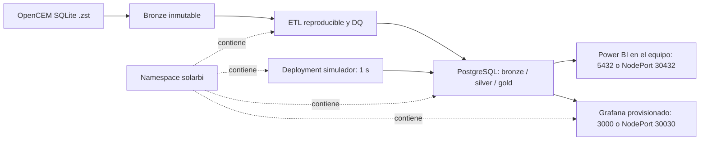

# Arquitectura y despliegue

Compose se usa en desarrollo local para que un solo `.\run.ps1 up` construya la imagen propia y levante PostgreSQL, ETL, simulador y Grafana. Kubernetes local se implementa en Docker Desktop: Namespace para aislar; StatefulSet + PVC para PostgreSQL; Deployment + PVC + ConfigMap de provisioning para Grafana; Job para ETL de una sola ejecucion; Deployment de una replica para simulacion; Service NodePort para anfitrion; Secret para claves; ConfigMap para parametros; readiness/liveness probes y requests/limits para recursos. PostgreSQL no se replica porque sus escrituras requieren coordinacion/almacenamiento compartido; Grafana podria escalar, pero el demo usa una replica y PVC local.

Power BI responde analisis historico, comparaciones y escenarios; Grafana responde estado de los ultimos minutos y alertas. No son intercambiables: difieren en latencia, interaccion analitica y usuarios. La ingesta directa futura agregaria un adaptador Modbus/SCADA con autenticacion, buffer/cola, esquema de eventos, timestamps monotonicamente ordenados, observabilidad y controles de OT; no se conectan dispositivos reales en este taller.

`docker compose down` conserva volumenes; reiniciar el pod de PostgreSQL no pierde el PVC. Eliminar el namespace de Kubernetes elimina sus PVC en este ejemplo local; la orden requiere confirmacion explicita en el script.
