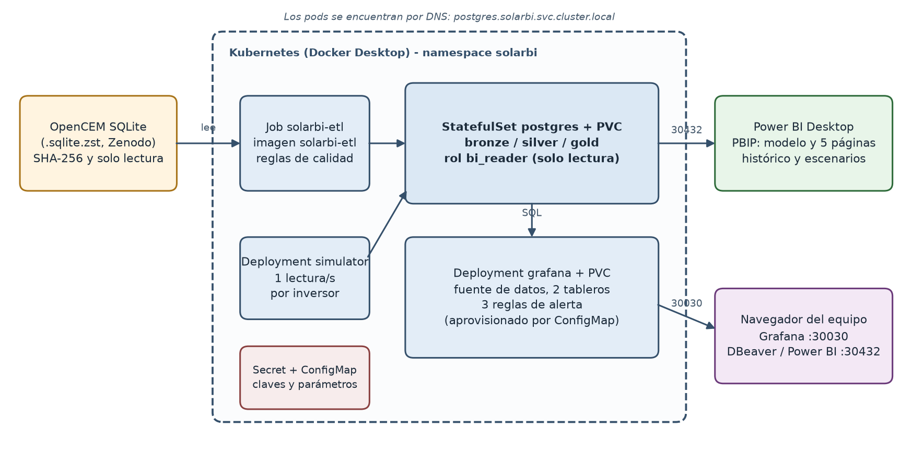
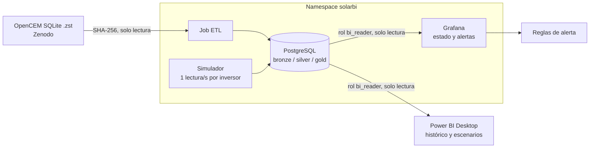

# Arquitectura y despliegue



El mismo diagrama en Mermaid, para editarlo:



Todo lo que está dentro del recuadro corre en el cluster. Power BI no se despliega: es una herramienta de escritorio que se conecta a PostgreSQL.

## Componentes

| Componente | Imagen | Función |
|---|---|---|
| PostgreSQL | `postgres:16.10-alpine3.22` | Almacén en tres capas; el esquema se crea desde `sql/schema.sql` |
| ETL y simulador | `solarbi-etl:1.0.0` (propia, `Dockerfile`) | Carga y valida la fuente; el mismo código genera la señal sintética |
| Grafana | `grafana/grafana:12.2.0` | Fuente de datos, dos tableros y tres reglas de alerta aprovisionados desde archivos |

La imagen propia parte de `python:3.12.11-slim-bookworm`, instala `requirements.txt` y copia `app/` y `sql/`; corre con un usuario sin privilegios y el archivo de datos no va en la imagen, se monta.

## Docker Compose

`.\run.ps1 up` crea el `.env` si no existe (con claves aleatorias), construye la imagen y levanta PostgreSQL, ETL, simulador y Grafana; el simulador espera a que el ETL termine y la base esté sana. `.\run.ps1 up -Demo` carga solo 14 días de marzo de 2026 para levantar rápido en una demostración. `.\run.ps1 down` detiene sin borrar volúmenes.

## Kubernetes (Docker Desktop)

`.\run.ps1 k8s-up` aplica los manifiestos de `k8s/` en el namespace `solarbi` y espera a que cada pieza esté lista; `.\run.ps1 k8s-down` elimina el namespace. Los recursos:

| Objeto | Nombre | Por qué este tipo |
|---|---|---|
| Namespace | `solarbi` | Aísla los recursos y permite borrarlos todos con un solo comando |
| StatefulSet + PVC | `postgres`, `postgres-data` (10 GiB) | La base es un servicio con estado: necesita identidad estable y un volumen que sobreviva al pod. Una réplica, porque PostgreSQL no se replica solo con más pods |
| Deployment + PVC | `grafana`, `grafana-data` (1 GiB) | Sin estado crítico (el aprovisionamiento lo recrea); el PVC conserva usuarios y preferencias |
| ConfigMap | `solarbi-config` | Parámetros no secretos: factor de CO2, tarifa, intervalo máximo, ventana del ETL |
| ConfigMap | `postgres-schema`, `grafana-provisioning`, `grafana-dashboard` | Esquema SQL y archivos de Grafana, generados desde los mismos archivos versionados |
| Secret | `solarbi-secrets` | Claves de PostgreSQL, del rol lector y de Grafana; se crea desde `.env` y no se versiona (`k8s/secret.example.yml` solo documenta el formato) |
| Job | `solarbi-etl` | La carga histórica es una tarea que termina; `backoffLimit: 1` evita reintentos infinitos |
| Deployment | `simulator` | Proceso continuo de una réplica. Se eligió Deployment y no CronJob porque la señal es de un segundo; un CronJob no baja de un minuto |
| Service ClusterIP | `postgres` | Nombre DNS estable dentro del cluster (`postgres.solarbi.svc.cluster.local`); Grafana, el ETL y el simulador usan solo `postgres` |
| Service NodePort | `postgres-nodeport` (30432), `grafana` (30030) | Acceso desde el anfitrión |

Sondas y recursos:

| Pod | Sondas | Requests | Limits |
|---|---|---|---|
| PostgreSQL | readiness y liveness con `pg_isready` | 250m, 512 Mi | 2 CPU, 1,25 Gi |
| Grafana | startup, readiness y liveness sobre `/api/health` | 200m, 256 Mi | 1 CPU, 512 Mi |
| ETL (Job) | | 250m, 256 Mi | 1 CPU, 640 Mi |
| Simulador | | 50m, 64 Mi | 300m, 96 Mi |

El límite de memoria del ETL es bajo a propósito: el ETL lee por lotes y escribe en PostgreSQL, así que no necesita tener la fuente en memoria, y el cluster de Docker Desktop dispone de unos 3,9 GiB.

### Acceso desde el anfitrión

En Docker Desktop para Windows los NodePort no siempre responden desde el anfitrión; se usan los túneles:

```powershell
kubectl port-forward -n solarbi service/grafana 30030:3000
kubectl port-forward -n solarbi service/postgres-nodeport 30432:5432
```

Grafana queda en `http://localhost:30030`; DBeaver y Power BI se conectan a `localhost:30432`.

### Recuperación

Si se borra el pod de PostgreSQL (`kubectl delete pod -n solarbi -l app=postgres`), el StatefulSet lo recrea y monta el mismo PVC: las filas siguen ahí. Si se borra el pod de Grafana, el Deployment lo recrea y el aprovisionamiento restaura fuente de datos, tableros y reglas. El simulador reanuda desde el reloj actual.

## Power BI frente a Grafana

| | Power BI | Grafana |
|---|---|---|
| Pregunta que responde | ¿Qué pasó y qué pasaría si...? Histórico, comparaciones, escenarios | ¿Qué está pasando ahora y debo actuar? Estado y alertas |
| Latencia | Importa datos y se actualiza a demanda | Consulta cada pocos segundos |
| Modelo | Esquema estrella con medidas DAX, inteligencia de tiempo, parámetros what-if | Consultas SQL por panel, variables, alertas |
| Usuario | Dirección, analista de sostenibilidad | Operación y mantenimiento |
| Mejor para | Balance mensual, CO2, disponibilidad, escenarios | Estado de carga, flujo vivo, reglas de alerta |

No son intercambiables: Power BI no evalúa reglas de alerta en continuo y Grafana no ofrece modelado semántico ni inteligencia de tiempo.

## Evolución: ingesta directa por Modbus o SCADA

Hoy los datos llegan desde un archivo histórico y un simulador. En una instalación real habría que añadir:

1. Un adaptador que lea los inversores por Modbus (o se suscriba al SCADA/historiador) con reintentos y tiempos de espera.
2. Una cola o buffer (MQTT, Kafka o una tabla de paso) para absorber caídas de la red sin perder lecturas.
3. Marcas de tiempo del dispositivo, con sincronización de reloj, para evitar los huecos y saltos que se ven en la fuente.
4. Control de acceso a la red de operación: el adaptador solo lee, desde un segmento aislado, sin escribir registros del equipo.
5. Observabilidad del propio flujo (lecturas por minuto, latencia, errores), que es lo que ya ensaya la regla de "flujo sin lecturas recientes".
6. Un diccionario de registros por modelo de inversor, para no repetir la ambigüedad de canales como `gridpowerw_a`.

El modelo dimensional y los tableros no cambiarían: solo cambiaría quién escribe en Bronze.
